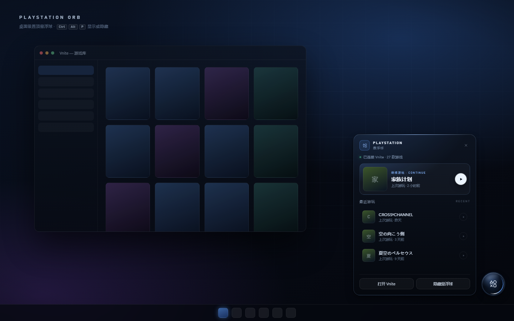
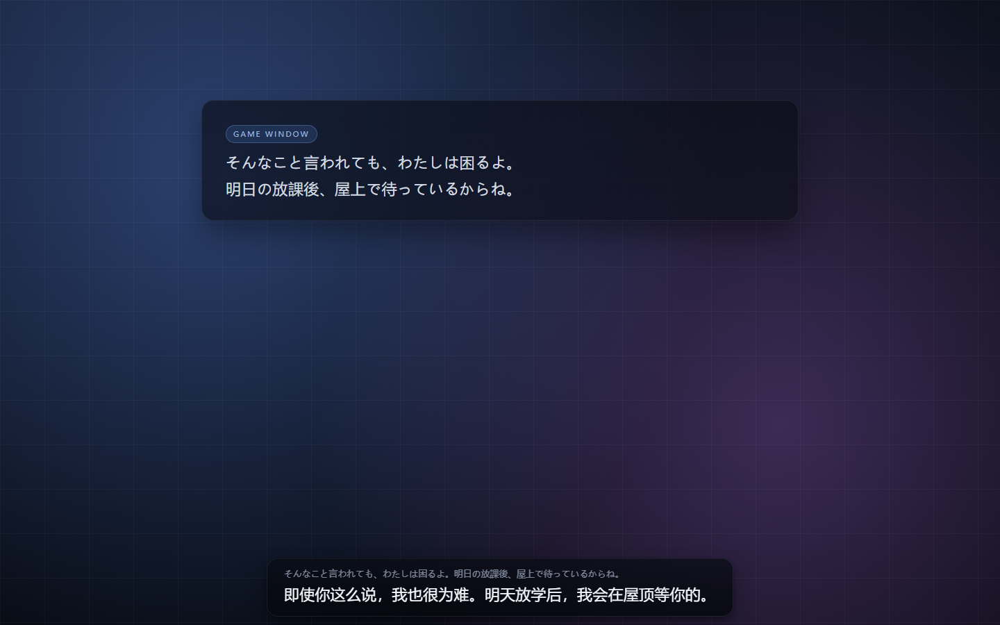
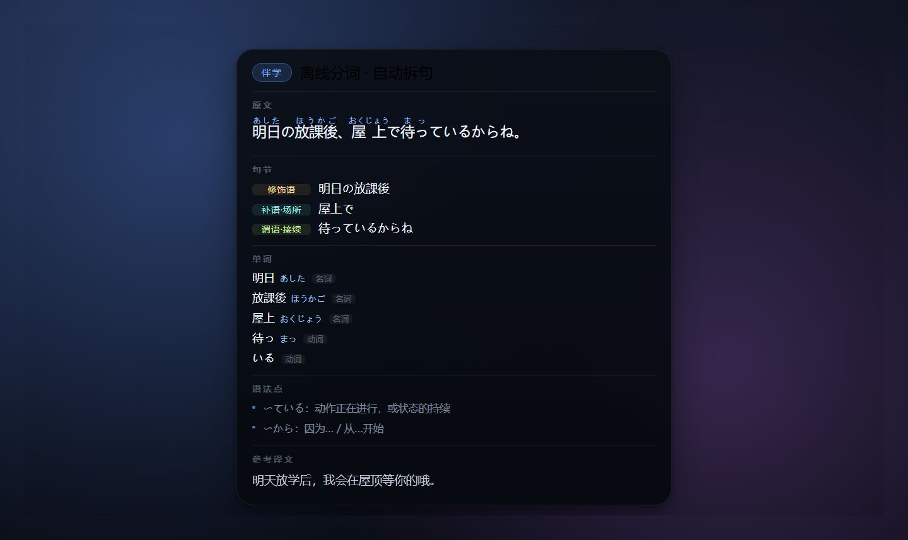

# PlayStation 悬浮球 for Vnite

一个 [Vnite](https://github.com/Project-HAMi/Vnite) 本地插件：在桌面上放一枚真正置顶的 PlayStation 风格悬浮球，并给外文 Galgame 配上实时翻译字幕和离线伴学面板。

悬浮球不是 Vnite 窗口里的挂件——插件会创建透明、无边框、始终置顶的独立窗口，所以无论你在看游戏、网页还是桌面，它都在。



> 预览图使用模拟桌面，悬浮球本体是一个透明窗口。

| 实时翻译字幕 | 伴学面板 |
| --- | --- |
|  |  |

## 功能

### 悬浮球

- 透明、无边框、跳过任务栏、始终置顶，可拖到任意位置，重启后位置保留
- 点击展开 PS 风格菜单：继续游玩、最近三款游戏、打开 Vnite、隐藏悬浮球
- 呼吸光环、旋转光弧、按压与拖动反馈；展开/合上/启动音效由 Web Audio 合成
- 菜单封面读取 Vnite 图库，无封面时用首字与色相兜底；遵循 Vnite 的 NSFW 过滤与模糊设置
- 托盘菜单注入「显示悬浮球 / 隐藏悬浮球」「实时翻译」「框选翻译区域」
- 快捷键：`Ctrl+Alt+P` 显示/隐藏，`Ctrl+Alt+O` 开关翻译，`Ctrl+Alt+R` 重新框选

### 实时翻译字幕

- 框选游戏对话框区域，换台词时自动截屏 → OCR → 翻译 → 底部/顶部字幕条
- 默认 **PaddleOCR（PP-OCRv5 检测 + 识别，ONNX Runtime 本地推理）**：对描边字、半透明对话框更稳，整句基本一次认对；识别跑在独立 Node 子进程里，模型随插件包分发，不需要联网或系统语言包
- 识别结果用离线词典自检：生词率过高时放大 1.5 倍复检，两份都像乱码就跳过这一帧，不把垃圾送进翻译
- 同一角色按出现次数投票统一写法，OCR 把生僻名字读成形近字（壬→王）会自动归并；兼容 `【武】`、`［武］`、`【武」`、`「武」「台词」`、`武「台词」` 等游戏里常见的写法
- 画面抖动去重、字幕区先涂黑再识别，避免把自己的译文二次识别
- 翻译在 OCR 循环之外单飞处理，换句不再等网络往返；新句会顶掉还没翻完的旧句
- 字幕条宽度贴合文字，原文先上屏、译文随后补上；主题色从游戏画面采样
- **四种字幕皮肤**：深色玻璃、亮白、暖纸、极简无底板，设置里随时切换

### 伴学面板

- 离线分词（[kuromoji](https://github.com/takuyaa/kuromoji.js) + IPADIC），原文带振假名
- 按助词切分句节并标注成分：主题 / 主语 / 宾语 / 补语 / 谓语·接续 / 修饰语
- 只列实词（名词、动词、形容词、副词等），重复词合并；点单词看完整词条：读音、音调、罗马字、词性、JLPT 等级、多义项和日汉例句（有道日语词典，未收录时回落翻译引擎）
- 常见语法点提示（ている・てしまう・ても・れる・させる・ながら 等）
- 生词本：点词自动收录、单条删除、遮住释义自测、导出 CSV
- 历史：最近 20 句原文与译文
- 人名：按票数决定标准写法，支持手动改正并应用到整部作品
- 面板可拖动、可缩放，位置大小自动记住

## 安装

1. 在 [Releases](../../releases) 下载最新的 `local-vnite-ps-orb-x.y.z.vnpkg`
2. 打开 Vnite → 设置 → 插件 → 安装本地插件，选择该文件
3. 启用「PlayStation 悬浮球」

启用后悬浮球会出现在主屏右下角、任务栏上方。

> **更新插件版本后请完全退出 Vnite 再启动。** Vnite 会缓存已加载的插件模块，只关窗口不算退出；日志里出现 `翻译启动 vX.Y.Z` 才说明新版本已生效。

### 手动安装

1. 退出 Vnite
2. 把 `plugin/` 里的内容复制到 `%APPDATA%\vnite\app\plugins\local-vnite-ps-orb\`
3. 启动 Vnite → 设置 → 插件 → 启用

## 使用

| 操作 | 效果 |
| --- | --- |
| 单击悬浮球 | 展开 / 收起菜单 |
| 按住拖动 | 移动悬浮球，松手记住位置 |
| 菜单里的封面 / 播放按钮 | 启动该游戏 |
| 「打开 Vnite」 | 还原并置前 Vnite 窗口 |
| 「隐藏悬浮球」 | 收起并隐藏，可从托盘菜单或 `Ctrl+Alt+P` 重新显示 |
| 右键悬浮球 | 菜单、打开 Vnite、设置、重置位置、隐藏 |
| 面板底部「实时翻译」/「框选区域」 | 开关字幕翻译 / 重新选择识别范围 |
| `Ctrl+Alt+P` / `Ctrl+Alt+O` / `Ctrl+Alt+R` | 显示隐藏悬浮球 / 开关翻译 / 重新框选 |
| `Esc` | 收起菜单 |

### 实时翻译起步

1. 托盘菜单 →「框选翻译区域」，拖一个框罩住对话框文字（避开立绘和特效）
2. 打开面板的「实时翻译」，或按 `Ctrl+Alt+O`
3. 字幕条会贴到游戏所在屏幕的底部中间，鼠标可穿透

## 配置

| 配置项 | 默认值 | 说明 |
| --- | --- | --- |
| 悬浮球大小 | 中 (64px) | 小 52 / 中 64 / 大 76 |
| 强调色 | 经典蓝 | 经典蓝 / 午夜紫 / 极光青 |
| 音效 | 开 | 展开、合上、启动提示音 |
| 快捷键 Ctrl+Alt+P | 开 | 关闭后不再注册该全局快捷键 |
| 实时翻译字幕 | 关 | 字幕翻译总开关 |
| OCR 引擎 | PaddleOCR | PaddleOCR（更准）/ Windows 自带 OCR（轻量，需日语语言包） |
| 翻译引擎 | 腾讯交互翻译 | 腾讯（免费）/ 谷歌（免费，需可访问）/ OpenAI 兼容（Sakura、Ollama、DeepSeek 等） |
| 原文语言 | 日语 | OCR 与翻译的源语言 |
| 接口地址 / 密钥 / 模型 | — | 仅 OpenAI 兼容引擎使用 |
| 仅前台窗口翻译 | 开 | 游戏被其他窗口盖住时暂停识别 |
| 主题取色 | 开 | 从画面采样主色，字幕条强调色跟着变 |
| 字幕皮肤 | 深色玻璃 | 深色玻璃 / 亮白 / 暖纸 / 极简无底板 |
| 字幕位置 | 底部 | 底部 / 顶部，避开画面中上的对话框 |
| 字幕间距 | 贴边 | 额外 0 / 40 / 80 / 120 px |
| 字幕字号 | 中 (22px) | 18 / 22 / 26 / 30 px |
| 字幕显示原文 | 开 | 在译文上方显示 OCR 结果 |
| 伴学面板 | 关 | 右侧显示振假名 / 句节 / 词性 / 语法点 |
| 使用系统画面流 | 关 | 用系统捕获流取画，CPU 更低；Windows 11 会显示捕获提示条 |
| 识别间隔 | 0.6 秒 | 0.6 / 1 / 1.5 / 2 秒 |

## 数据与隐私

- OCR（PaddleOCR / Windows OCR）、分词（kuromoji）、生词本全部在本地完成，模型随插件包分发
- 默认翻译走腾讯交互翻译的公开接口，会把**识别出的台词文本**发送到对应服务；换成 OpenAI 兼容的本地 Ollama 即可完全离线
- 查词走有道的公开词典接口，只发送单个单词
- 运行状态保存在 `%APPDATA%\vnite\plugins\local-vnite-ps-orb\state.json`（悬浮球位置、人物名、生词本、框选区域）
- 诊断日志 `translate.log` 记录 OCR 纠错与人名纠正过程，超过 512KB 自动轮转；日志可能包含识别到的台词文本，介意可随时删除

## 兼容性

- Vnite 4.14.x
- Windows 10 / 11（透明窗口、置顶、PaddleOCR 已验证）
- macOS / Linux 依赖系统合成器，未做完整测试

## 项目结构

```
plugin/                插件本体，直接打包为 .vnpkg
  index.cjs            悬浮球主进程：窗口、托盘、快捷键、配置轮询
  orb.html/css/js      悬浮球与展开面板
  translator.cjs       字幕翻译编排：抓屏、OCR、翻译、人名纠正、生词本
  subtitle.html/css/js 字幕条（含说话人徽章与皮肤）
  study.html/css/js    伴学面板
  analyzer.cjs         kuromoji 离线分词、句节切分、语法点
  ovr.ps1              常驻 PowerShell 助手：GDI 抓屏 + Windows OCR
  ocr-paddle.cjs       PaddleOCR ONNX 推理子进程（stdin/stdout JSON）
  models/              PP-OCRv5 det / rec 模型与字典
  capture.html/js      可选的系统画面流取画
  overlay.html/css/js  框选识别区域
  channels.cjs         所有 IPC 频道名
  preload.cjs          contextBridge 暴露的最小接口
  manifest.json        插件清单与全部配置项
preview/               浏览器里的 UI 预览（没有 Vnite 时进入演示模式）
tools/                 图标生成、打包脚本
docs/                  README 截图
```

## 开发

环境：Node.js 18+、Windows 10/11、Vnite 4.14.x。

```bash
# 安装运行时依赖（kuromoji、onnxruntime-node）
npm install --prefix plugin

# 语法检查
node --check plugin/index.cjs
node --check plugin/translator.cjs
node --check plugin/subtitle.js

# 浏览器预览（演示模式）
python -m http.server 5180 --directory preview
# 打开 http://127.0.0.1:5180/
```

打包：

```powershell
pwsh tools/build.ps1
# 产物：dist/local-vnite-ps-orb-<version>.vnpkg
```

图标由 `tools/make_icon.ps1` 生成。

## 常见问题

**改了设置或更新版本后没变化？**
Vnite 会缓存已加载的插件模块。请完全退出 Vnite（托盘右键退出，或结束所有 `Vnite.exe` 进程）再启动，确认 `translate.log` 里出现 `翻译启动 v1.21.0`。只点窗口关闭按钮只是最小化到托盘。

**字幕识别不到 / 经常跳帧？**
检查框选区域是否只罩住对话框文字；「仅前台窗口翻译」开启时，游戏被聊天窗口盖住会暂停；日志里会写明本帧是 `skip`、`wait` 还是判定为乱码。

**PaddleOCR 不可用？**
插件会提示并自动回落到 Windows 自带 OCR，5 分钟后自动重试。回落时需要系统日语语言包（设置 → 时间和语言 → 语言）；日志报 `no-ocr-engine` 就装一下日语。模型文件缺失时重装插件包即可。

**全文独显游戏挡住了悬浮球？**
独占全屏会盖住所有置顶窗口，这是系统行为。改用游戏的「无边框窗口 / 窗口化全屏」模式即可。

**翻译偶尔很离谱？**
免费翻译接口对拟声词、方言和很短的口语片段效果有限。对画质要求高时，建议在设置里换成 Sakura、DeepSeek 等 OpenAI 兼容引擎。

## 致谢

- [Vnite](https://github.com/Project-HAMi/Vnite)：插件宿主
- [kuromoji.js](https://github.com/takuyaa/kuromoji.js) + IPADIC：离线分词
- [PaddleOCR](https://github.com/PaddlePaddle/PaddleOCR) PP-OCRv5 模型（Apache-2.0）与 [onnxruntime-node](https://github.com/microsoft/onnxruntime)
- [LunaTranslator](https://github.com/HIllya51/LunaTranslator)：抓屏与稳定帧识别的思路参考
- 有道日语词典、腾讯交互翻译、Google 翻译：查词与翻译接口

## License

[MIT](LICENSE)
