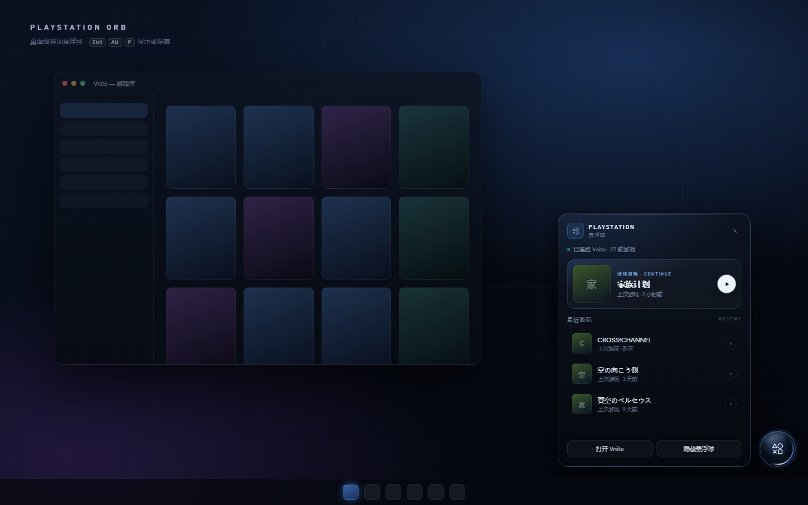

# PlayStation 悬浮球

一枚真正浮在桌面上的 PlayStation 风格悬浮球。它不是 Vnite 窗口里的挂件：插件会创建一个透明、无边框、始终置顶的独立小窗口，因此无论你在看网页、桌面还是别的应用，它都在。



> 预览图使用模拟桌面，悬浮球本体是一个透明窗口。

## 功能

- 桌面级悬浮：透明、无边框、跳过任务栏、始终置顶
- 拖动到任意位置，退出 Vnite 后位置仍然保留
- 点击展开 PS 风格菜单：继续游玩、最近三款游戏、打开 Vnite、隐藏悬浮球
- 球体带呼吸光环、旋转光弧、按压与拖动反馈
- 菜单里的封面读取 Vnite 图库；没有封面时用首字与色相兜底
- 遵循 Vnite 的 NSFW 过滤与模糊设置
- `Ctrl+Alt+P` 显示或隐藏悬浮球
- Vnite 托盘菜单里有「显示悬浮球 / 隐藏悬浮球」，隐藏后从这里也能唤出
- 可选展开/合上/启动提示音，全部由 Web Audio 合成

## 安装

### 安装包（推荐）

1. 下载 `local-vnite-ps-orb-1.0.13.vnpkg`
2. 打开 Vnite → 设置 → 插件 → 安装本地插件，选择该文件
3. 启用「PlayStation 悬浮球」

启用后悬浮球会出现在主屏右下角、任务栏上方。

### 手动安装

1. 退出 Vnite
2. 把 `plugin/` 里的内容复制到
   `%APPDATA%\vnite\app\plugins\local-vnite-ps-orb\`
3. 启动 Vnite → 设置 → 插件 → 启用

## 使用

| 操作 | 效果 |
| --- | --- |
| 单击悬浮球 | 展开或收起菜单 |
| 按住拖动 | 移动悬浮球，松手后记住位置；菜单展开时菜单会跟着一起移动 |
| 菜单里的封面 / 播放按钮 | 启动该游戏 |
| 「打开 Vnite」 | 把 Vnite 窗口还原并置前 |
| 「隐藏悬浮球」 | 收起并隐藏，可从 Vnite 托盘菜单或 `Ctrl+Alt+P` 重新显示 |
| Vnite 托盘菜单 →「显示悬浮球」 | 隐藏后重新唤出悬浮球 |
| 右键悬浮球 | 展开/收起菜单、打开 Vnite、设置（面板内直接调大小/配色/音效）、重置位置、隐藏悬浮球 |
| `Ctrl+Alt+P` | 显示 / 隐藏悬浮球 |
| `Esc` | 收起菜单 |

菜单展开时点击桌面其它位置会自动收起。

## 配置

| 配置项 | 默认值 | 说明 |
| --- | --- | --- |
| 悬浮球大小 | 中 (64px) | 小 52px / 中 64px / 大 76px |
| 强调色 | 经典蓝 | 经典蓝 / 午夜紫 / 极光青 |
| 音效 | 开 | 展开、合上与启动的短提示音 |
| 快捷键 Ctrl+Alt+P | 开 | 关闭后不再注册全局快捷键 |

位置保存在 `%APPDATA%\vnite\plugins\local-vnite-ps-orb\state.json`（Vnite 的 userData 目录下）。换显示器或分辨率变化时会自动夹回可见区域。

## 说明

- 窗口尺寸始终按展开后的布局固定，展开/收起只切换菜单显隐，悬浮球不会移动，也不会因为改窗口大小而闪动。
- 透明区域通过 `setIgnoreMouseEvents(true, { forward: true })` 让鼠标穿透到桌面，只有悬浮球和菜单区域会接收点击。
- 托盘入口通过钩住 Electron `Tray.setContextMenu` 注入：Vnite 每次重建托盘菜单（最近游玩、语言切换、设置变更）都会自动补上，插件停用后自动移除。
- 菜单里的「最近游玩」按 `lastRunDate` 排序，最多显示四款（一款主推 + 三款列表）。
- 启动游戏沿用 Vnite 的 `game:start-from-url` 通道，和插件外的手动启动行为一致。
- 悬浮球始终置顶，独占全屏的游戏可能覆盖在它之上；这是系统层面的正常行为。
- 如果 `Ctrl+Alt+P` 被其它程序占用，插件会在日志里提示，悬浮球本身仍可正常点击使用。

## 实现说明

- 主进程用 `BrowserWindow` 创建透明窗口：`frame: false`、`transparent: true`、`alwaysOnTop`、`skipTaskbar`
- 渲染层通过 preload 暴露的最小 IPC 接口操作窗口，开启 `contextIsolation`，关闭 `nodeIntegration`
- 拖动由渲染层上报指针位移、主进程换算屏幕坐标后 `setPosition`，避免 `-webkit-app-region: drag` 吞掉点击
- 展开时按悬浮球所在的屏幕半区决定菜单在球的左侧还是右侧、上方还是下方，始终朝屏幕内侧展开
- 插件停用会关闭窗口、注销快捷键、移除 IPC 与显示器监听

## 兼容性

- Vnite 4.14.x
- Windows 10/11（透明窗口与置顶已验证）；macOS / Linux 依赖系统合成器

## 开发

```bash
node --check plugin/index.cjs
node --check plugin/preload.cjs
node --check plugin/orb.js
```

浏览器预览（没有 Vnite 时会自动进入演示模式）：

```bash
python -m http.server 5180 --directory preview
# http://127.0.0.1:5180/
```

## License

[MIT](LICENSE)
